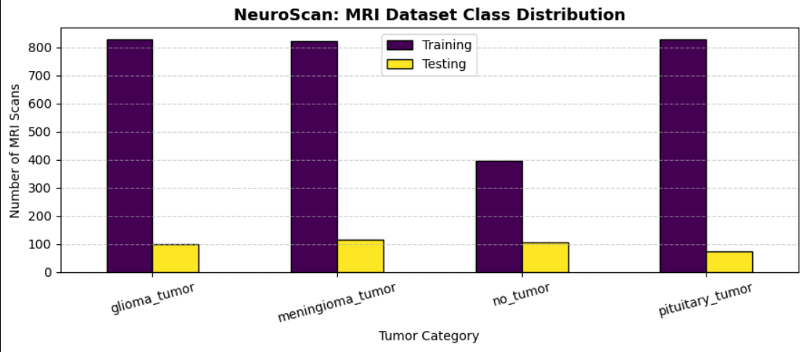
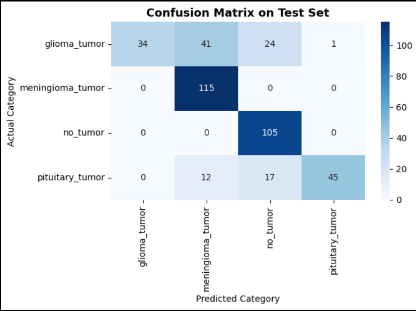
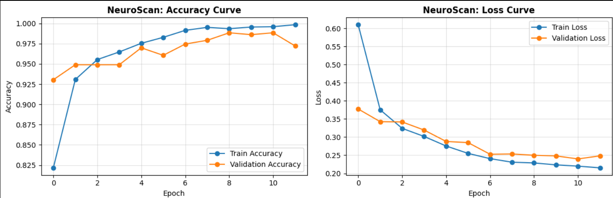

# 🧠 NeuroScan — Brain Tumor Classification Using MRI Images

**NeuroScan** is a deep-learning project that classifies brain MRI images into four categories using transfer learning with MobileNetV2 and PyTorch.

The project explores image preprocessing, data augmentation, model training, and evaluation to understand how deep-learning techniques can be applied to medical image classification.

> **Disclaimer:** This is an academic project for educational and research purposes only. It is not intended for medical diagnosis or clinical decision-making.

## 📌 Table of Contents

- [Project Overview](#-project-overview)
- [Objectives](#-objectives)
- [Dataset](#-dataset)
- [Technology Stack](#-technology-stack)
- [Methodology](#-methodology)
- [Model Architecture](#-model-architecture)
- [Results](#-results)
- [Limitations](#-limitations)
- [Project Structure](#-project-structure)
- [Installation and Setup](#-installation-and-setup)
- [Future Improvements](#-future-improvements)

## 📖 Project Overview

Brain MRI images contain visual patterns that can help distinguish different brain tumour categories. This project develops an image-classification pipeline using a pretrained convolutional neural network.

NeuroScan uses **MobileNetV2 with transfer learning** to classify MRI images into four categories. A pretrained model provides the initial visual features, while a custom classification head is trained for the target classes.

The project includes dataset exploration, image preprocessing, training, validation, testing, and visual analysis of predictions.

## 🎯 Objectives

- Analyse the distribution of MRI images across the target classes.
- Preprocess and augment images for deep-learning training.
- Implement transfer learning using MobileNetV2.
- Train and validate a multiclass image-classification model.
- Evaluate performance using accuracy, precision, recall, and F1-score.
- Visualise the confusion matrix, training curves, and sample predictions.
- Identify model limitations and opportunities for improvement.

## 📂 Dataset

The project uses the **Brain Tumor Classification (MRI)** dataset by Sartaj Bhuvaji and other contributors, available on Kaggle.

**Dataset:** [Brain Tumor Classification (MRI)](https://www.kaggle.com/datasets/sartajbhuvaji/brain-tumor-classification-mri)

The dataset contains four classes:

| Class | Training Images | Testing Images |
|---|---:|---:|
| Glioma Tumour | 826 | 100 |
| Meningioma Tumour | 822 | 115 |
| No Tumour | 395 | 105 |
| Pituitary Tumour | 827 | 74 |
| **Total** | **2,870** | **394** |

The training folder is divided into training and validation subsets:

- Training: 2,439 images
- Validation: 431 images
- Separate testing folder: 394 images

## 🛠️ Technology Stack

- **Python** — Programming language
- **PyTorch** — Deep-learning model development and training
- **Torchvision** — Pretrained models, image transformations, and dataset loading
- **NumPy and pandas** — Data handling and analysis
- **Matplotlib and Seaborn** — Data visualisation
- **Scikit-learn** — Data splitting and classification evaluation
- **Pillow** — Image processing
- **Kaggle Notebook** — Development and GPU-based execution

## ⚙️ Methodology

### 1. Data Exploration
Inspected the training and testing folders and analysed the number of images in each class.

### 2. Image Preprocessing
Resized images to 224 × 224 pixels and normalised them using ImageNet mean and standard deviation values.

### 3. Data Augmentation
Applied random horizontal flipping, rotation, brightness adjustment, and contrast adjustment to training images.

### 4. Transfer Learning
Used MobileNetV2 pretrained on ImageNet as the feature-extraction backbone. The first ten feature blocks were frozen, while the remaining feature layers were fine-tuned.

### 5. Model Training
Trained the model for 12 epochs using AdamW, cross-entropy loss with label smoothing, and cosine-annealing learning-rate scheduling. Mixed-precision training was enabled when CUDA was available.

### 6. Model Evaluation
Evaluated the selected model on the separate testing folder using accuracy, precision, recall, F1-score, a confusion matrix, and sample predictions.

## 🧠 Model Architecture

The model consists of:

1. **Input:** RGB MRI images resized to 224 × 224 pixels.
2. **Feature extractor:** ImageNet-pretrained MobileNetV2.
3. **Dropout:** 0.3.
4. **Fully connected layer:** 256 units.
5. **ReLU activation.**
6. **Dropout:** 0.2.
7. **Output layer:** Four class scores.

The model uses transfer learning to adapt general image features to the brain MRI classification task.

## 📊 Results

The project achieved the following recorded results:

| Evaluation Metric | Result |
|---|---:|
| Best validation accuracy | 98.84% |
| Test accuracy | 75.89% |
| Macro F1-score | 72.67% |
| Weighted F1-score | 72.98% |
| Test set size | 394 images |

**Important observation:** The test accuracy is substantially lower than the best validation accuracy. The model also performs unevenly across classes, particularly for glioma and pituitary tumour images.

These results highlight why test performance and class-wise recall must be considered alongside overall accuracy.

### 📈 Model Visualisations

#### 1. Dataset Class Distribution

This chart shows the distribution of MRI images across the four classification categories.



#### 2. Confusion Matrix

The confusion matrix illustrates the model's correct and incorrect predictions across the four classes.



#### 3. Training and Validation Curves

These curves show how the model's training and validation performance changed across epochs.



## ⚠️ Limitations

- The model's test accuracy is lower than its validation accuracy.
- Glioma and pituitary tumour cases are missed by the model.
- The dataset has an uneven class distribution.
- Evaluation is limited to one public dataset and a single training run.
- The model has not been externally or clinically validated.
- Softmax confidence scores should not be interpreted as reliable measures of diagnostic certainty.

This project must not be used to diagnose or rule out a brain tumour.

## 📁 Project Structure

The repository will be organised progressively as follows:

```text
NeuroScan-Brain-Tumor-Classification/
├── README.md
├── requirements.txt
├── .gitignore
├── notebooks/
│   └── NeuroScan_Brain_Tumor_Classification.ipynb
├── reports/
│   └── NeuroScan_Project_Report.pdf
├── outputs/
│   ├── class_distribution.png
│   ├── training_curves.png
│   └── confusion_matrix.png
└── src/
    ├── model.py
    └── evaluate.py
```

*Note: This is the planned structure. Files and folders will be added as the repository is organised.*

## 💻 Installation and Setup

### Prerequisites

- Python 3
- Git
- Access to the MRI dataset
- A compatible PyTorch environment

### Clone the Repository

```bash
git clone https://github.com/manishkachitra/NeuroScan-Brain-Tumor-Classification.git
cd NeuroScan-Brain-Tumor-Classification
```

### Install Dependencies

Once `requirements.txt` has been created:

```bash
pip install -r requirements.txt
```

### Run the Notebook

Open the project notebook in Jupyter Notebook or JupyterLab.

Download the dataset from the Kaggle link above and configure the dataset paths in the notebook to match your local folder structure. The notebook was originally developed in a Kaggle environment.

## 🔮 Future Improvements

- Investigate the validation–test performance gap.
- Explore class weighting or other approaches to address class imbalance.
- Improve recall for glioma and pituitary tumour classes.
- Evaluate alternative CNN architectures.
- Perform repeated experiments and cross-validation where appropriate.
- Explore Grad-CAM for visual model explainability.
- Investigate confidence calibration.
- Develop a web interface or API after further model evaluation.

## 👩‍💻 Author

**Manishka Chitra**

MBA — Data Science and Artificial Intelligence  
Chandigarh University

---

*NeuroScan is an academic deep-learning project intended for educational and research purposes.*
